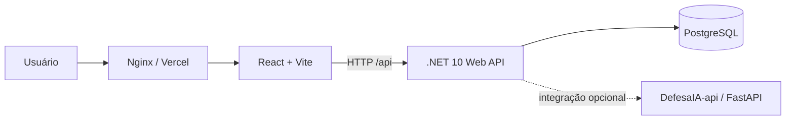

<!-- TODO: adicionar prints em docs/img/ -->

# DefesaERP

Sistema web de gestão operacional para a Defesa Civil, com backend em .NET 10 e frontend em React + TypeScript.

[](https://github.com/consultorluisdev/defesaERP/actions/workflows/ci.yml)

## Problema que resolve

A operação da Defesa Civil envolve ocorrências, alertas, equipes, solicitações e vistorias em processos separados. O DefesaERP centraliza esses registros em uma única aplicação, com autenticação, painel operacional e navegação por módulos.

## Funcionalidades

### Implementado

- [x] Autenticação com registro, login e logout.
- [x] Rotas protegidas no frontend.
- [x] JWT no backend com endpoint de refresh.
- [x] Tema claro e escuro.
- [x] Dashboard com indicadores e monitoramento, com fallback local quando a API não responde.
- [x] Ocorrências: listagem, criação, filtros, busca e detalhes.
- [x] Alertas: listagem, criação, edição, exclusão, filtros e detalhes.
- [x] Equipes: listagem, filtros, detalhes e formulário.
- [x] Solicitações: interface de listagem, criação, filtros e detalhes.
- [x] Vistorias: interface de listagem, criação, filtros e detalhes.
- [x] Radar: visualização de eventos com dados de demonstração.
- [x] Docker Compose com PostgreSQL, backend, frontend, serviço de IA e Portainer.
- [x] Aplicação automática de migrations no startup do backend.
- [x] Rate limiting básico e CORS configurável no backend.

### Em andamento ou pendente

- [ ] Backend de Solicitações.
- [ ] Backend de Vistorias.
- [ ] Backend do Radar.
- [ ] Correção do contrato de alteração de status de Ocorrências.
- [ ] Alinhamento completo do formulário e validação de Equipes.
- [ ] Riscos, Abrigos, Viaturas, Relatórios, Análises, Perfis e Configurações.
- [ ] IA Predict.
- [ ] Testes automatizados de backend e frontend.
- [ ] Persistência e renovação automática de refresh token no frontend.
- [ ] Deploy em produção.

## Stack

### Backend

- .NET 10
- C#
- ASP.NET Core Web API
- Entity Framework Core
- PostgreSQL
- Npgsql
- JWT
- BCrypt
- Swagger / OpenAPI

### Frontend

- React 19
- TypeScript
- Vite
- Tailwind CSS
- React Router
- Axios
- Lucide React
- React Icons

### Infraestrutura

- Docker
- Docker Compose
- PostgreSQL 17
- Nginx
- Portainer

## Arquitetura



## Estrutura do repositório

```text
defesaERP/
├── backend/
│   ├── DefesaCivil.Api/      API principal em .NET
│   └── DefesaIA-api/         Scaffold FastAPI pausado
├── frontend/
│   └── defesa-web/           Aplicação React + Vite
├── docs/                     Auditoria, segurança e perfil
├── docker-compose.yml
├── docker-compose.dev.yml
└── README.md
```

## Como rodar

### Pré-requisitos

- Docker e Docker Compose
- .NET 10 SDK, para rodar o backend fora do Docker
- Node.js 22 e npm, para rodar o frontend fora do Docker

### Com Docker

```bash
cp .env.example .env
```

Edite o `.env` e defina:

```text
POSTGRES_PASSWORD=uma-senha-forte
JWT_KEY=uma-chave-com-pelo-menos-32-caracteres
```

Suba o ambiente:

```bash
docker compose up -d --build
docker compose ps
```

Acesse:

| Serviço | URL |
|---|---|
| Frontend | http://localhost:3000 |
| API | http://localhost:8080/api |
| IA | http://localhost:8001 |
| Postgres | localhost:5435 |
| Portainer | http://localhost:9001 |

Crie a primeira conta em `http://localhost:3000/register`.

Para desenvolvimento com hot reload:

```bash
docker compose -f docker-compose.dev.yml up --build
```

### Backend local

```bash
dotnet restore backend/backend.sln
dotnet build backend/backend.sln
dotnet run --project backend/DefesaCivil.Api
```

O backend exige `ConnectionStrings__Default` e `Jwt__Key` configurados.

### Frontend local

```bash
cd frontend/defesa-web
npm ci
VITE_API_URL=http://localhost:8080/api npm run dev
```

## Testes e validação

### Backend

```bash
dotnet build backend/backend.sln
```

Ainda não existe projeto de testes no backend, então `dotnet test` não executa casos de teste no momento.

### Frontend

```bash
cd frontend/defesa-web
npm ci
npm run lint
npx tsc -p tsconfig.app.json --noEmit
npm run build
```

O build do Vite gera a pasta `dist/`.

## Variáveis de ambiente

```text
POSTGRES_PASSWORD
JWT_KEY
POSTGRES_PORT
POSTGRES_PORT_DEV
CORS_ALLOWED_ORIGINS
VITE_API_URL
DEFESA_IA_URL
```

Os valores reais ficam no `.env`, que não é versionado. Use `.env.example` como base.

## Status e roadmap

### Concluído

- [x] Estrutura full stack com Docker Compose.
- [x] Autenticação JWT e proteção de rotas.
- [x] Dashboard, Ocorrências, Alertas e Equipes.
- [x] Interfaces de Solicitações, Vistorias e Radar.
- [x] Estrutura inicial dos demais módulos.
- [x] Pipeline de CI.

### Próximas etapas

- [ ] Backend de Solicitações e Vistorias.
- [ ] Backend do Radar.
- [ ] Correções de contrato em Ocorrências e Equipes.
- [ ] Implementação de Riscos, Abrigos, Viaturas, Relatórios, Análises, Perfis e Configurações.
- [ ] Testes automatizados.
- [ ] Deploy e documentação em inglês.

## Documentação

- [Auditoria](docs/AUDITORIA.md)
- [Segurança](docs/SEGURANCA.md)
- [Plano de entrega](PLANO_ENTREGA.md)
- [Checklist](CHECKLIST.md)

## Contato

- GitHub: [github.com/consultorluisdev](https://github.com/consultorluisdev)
